# Platypus: AI booking for phone-only businesses

**We make Main Street agent-native.** The agent economy stops at the phone. We don't.

*One call makes any phone-only business bookable by every AI agent. Call once, agent-native forever.*

`ai-agents` · `mcp` · `voice-agents` · `ai-booking` · `local-services` · `dial` · `darwin` · `alike` · `speedhacks` · `sf-tech-week` · `typescript`

[](https://github.com/KarthikSubramanian07/Platypus/actions/workflows/ci.yml) [](https://github.com/KarthikSubramanian07/Platypus/actions/workflows/codeql.yml)


**Live:** [tryplatypus.pages.dev](https://tryplatypus.pages.dev) replays the golden path in your browser, with no server and no signup.


Your agent can book a flight. It can't book Main Street. Most of the 33 million small businesses in the US ([SBA, 2023](https://advocacy.sba.gov/2023/03/07/frequently-asked-questions-about-small-business-2023/)) will never build an API, a booking widget or an agent of their own. They have a phone. Platypus meets them there, exactly once.

A customer's agent (Claude, Muse, anything that speaks MCP) calls our MCP tools. We ask Darwin whether an agent already covers the job. If none is ready, Dial places one AI call to the business. The call says it is an AI in its first sentence, gets a price and an opening, and books the job through our own tools while the owner is still on the line. Then it asks one more thing: *"Next time a customer's agent needs you, can I text you instead of calling?"* A yes is stored as consent, quoted word for word, and from then on every agent books that business by text. The owner answers with one letter.

> **The call is the onboarding, not the product.** Everyone else calls a business every time. We call it once, and every yes becomes supply for every agent. Consent compounds; calls don't.

<sub>A semi-aquatic, egg-laying agent of action. No platypuses were harmed in the making of this demo; one was given a fedora.</sub>

---

## For judges: the two-minute tour

| Criterion | Weight | Where to look |
| --- | --- | --- |
| **Problem and impact: time saved** | 40% | [Time saved](#time-saved): 15 to 25 minutes of calling around becomes under a minute of attention, with setup, review and corrections counted. The owner's 3 to 5 minute booking call becomes a 5 to 10 second text, after one 75-second call. |
| **Technical execution** | 25% | [Guarantees the code enforces](#guarantees-the-code-enforces): an evidence-only `confirm()`, consent rows the database refuses without proof, an append-only event log enforced by triggers, and a phone-number allowlist at the lowest layer. 777 tests run in CI. |
| **Market and path forward** | 15% | [Why now](#why-now), [the moat](#the-moat-consent-compounds-calls-dont) and [the business model](#business-model-and-path-forward): every lab shipped a calling agent in September; we sell to owners per confirmed job; ten real owners on Monday. |
| **Originality** | 10% | [The insight](#the-insight): everyone else calls a business every time; we call it once. The call books a real job *and* converts the business to agent-native in the same 75 seconds. Nobody installs anything. |
| **Product quality and demo** | 10% | [The live page](https://tryplatypus.pages.dev) replays the recorded golden path event by event, on desktop, iPad and phone. `pnpm dev` runs it locally with no keys. |
| **Best use of Dial, Darwin, Alike** | prizes | [Partner integrations](#partner-integrations): each one is load-bearing, and each has a "what breaks without it" line. |


---

## Why now

In one month, every lab shipped a personal agent. Then they all added phone calls.

| Date | What shipped |
| --- | --- |
| Sep 8 | **Meta launches Muse.** Books, shops, fills forms; 2.5M downloads in two weeks; calls US businesses in public beta from Sep 16. |
| Sep 16 | **Instinct Concierge** adds business calls in early access. Books call by call; nothing persists. |
| Sep 29 | **OpenAI launches Dots**, always-on agents inside ChatGPT. SMS "coming soon." |
| Oct 6 | **Personal Agent Protocol.** Three routes for a business: a website, an API, or its own agent. A three-person shop has none. |

Agents can book Delta and Walmart, and nothing in between. Websites are shutting the door on agents, the new standard skips the long tail, and businesses hang up when they hear an AI, so Meta tested human contractors on Muse calls. Demand arrived in four weeks. Nobody is connecting the businesses that run on a phone.

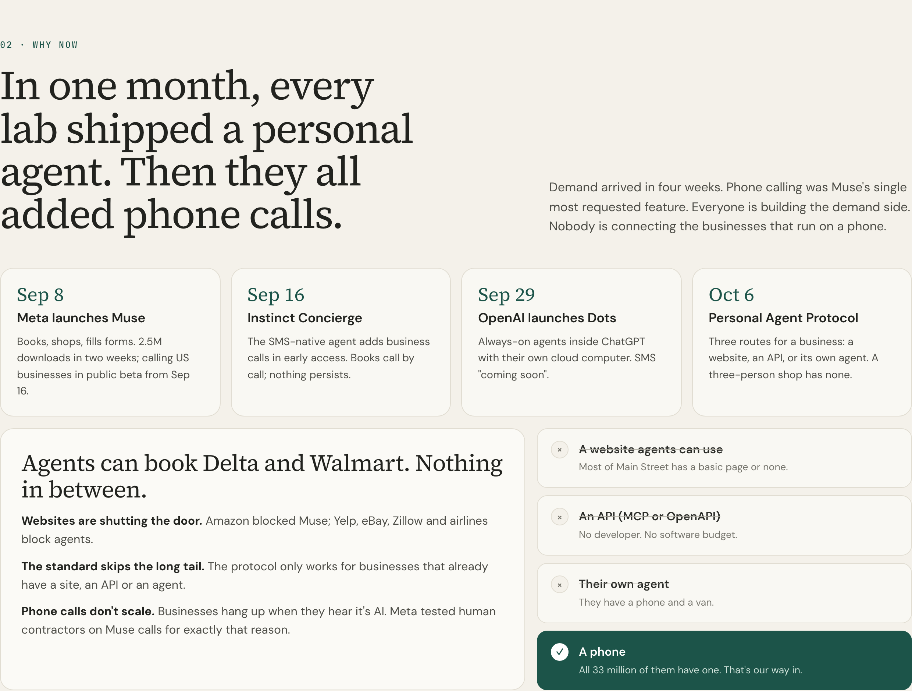

## The insight

**The call is the onboarding, not the product.** On that one call our agent says it's an AI, gets price and availability, books the job, and asks: *"Can I text you future requests instead of calling?"* A yes turns a phone number into supply that every agent platform can route to, forever. The owner keeps working the way they already do: by text, one word at a time.

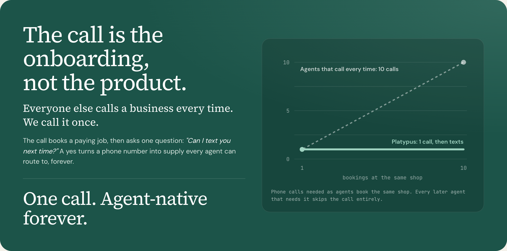

---

## The golden path

This is the demo, and the only thing that must work end to end.

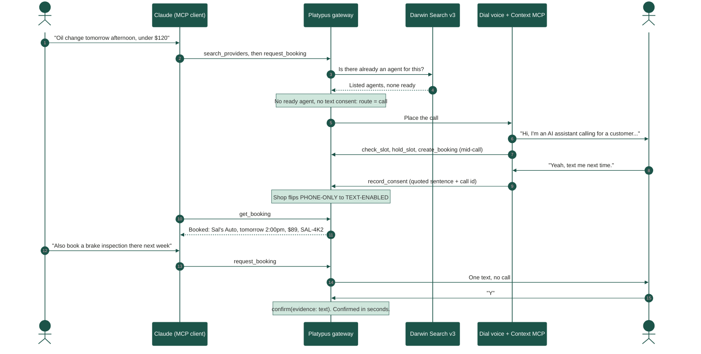

1. In Claude Desktop, a customer types: *"Oil change tomorrow afternoon, under $120, near 1025 Sansome."* Claude calls `search_providers`, then `request_booking`, on the Platypus MCP server.
2. The gateway runs Darwin Search v3 with the budget and deadline as context. When Darwin has no agent that is ready to take the job (for our trades it answers with listed agents, none of them ready), the dashboard shows that gap and its reason, and Platypus goes to the phone.
3. The gateway attaches routing signals for the candidate shop: typical price, median reply time, and acceptance rate.
4. There is no consent on record, so the route is **call**. Dial places an outbound call to Sal's Auto, which today is a teammate's phone. The AI discloses itself, then asks for a price and an opening.
5. During the call, the voice agent calls our tools through Dial's Context MCP: `check_slot`, `hold_slot`, `create_booking`, `record_consent` and `set_text_number`. Each one lights up on the dashboard.
6. The owner says *"Yeah, text me."* Consent is stored with that sentence and the call id, and Sal's card flips from PHONE-ONLY to TEXT-ENABLED.
7. Claude polls `get_booking` and renders a typed result: *Booked: Sal's Auto, tomorrow 2:00pm, $89, SAL-4K2.*
8. Second request: *"Also book a brake inspection there next week."* This time there is no call. The owner's phone gets a text (iMessage, WhatsApp or Dial), the owner replies **Y**, and the booking is confirmed within seconds.
9. The supply table shows six businesses: which are text-enabled, how fast each replies, and the last price.


---

## Time saved

> There are 104 days of summer vacation. Spend none of them on hold.

These are **transparent estimates**, not measurements. The rubric asks for setup, review and corrections to be counted, so they are.

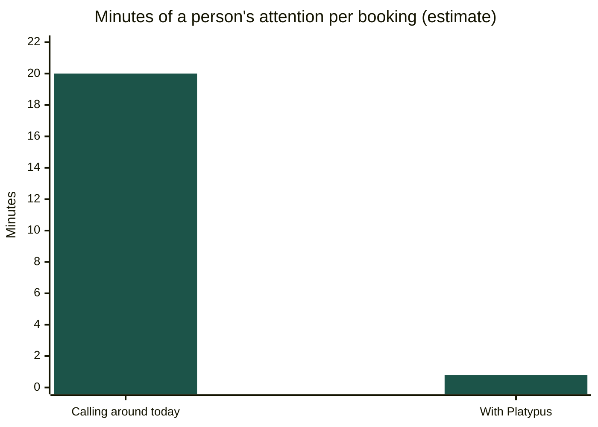

| Step | Today, calling around | With Platypus |
| --- | ---: | ---: |
| Setup | none | 2 min once to add the MCP server, amortized to about 0 |
| Find shops, read reviews | 4:00 | (Darwin and the gateway) |
| Call three shops: hold music, voicemail, "can I get a quote" | 9:00 | (Dial calls; you do something else) |
| Phone tag and callbacks | 5:00 | none |
| Type the request | (inside the calls) | 0:20 |
| Review the result and confirm details | 2:00 | 0:20 |
| Corrections: about 1 in 5 owners counter with another time | (more phone tag) | 0:10 averaged |
| **Your attention per booking** | **about 20 min (15 to 25)** | **about 0.8 min** |

- **Wall clock is not attention.** The first call takes about three minutes while the customer does something else. Every later booking is a text, answered in seconds.
- **The owner saves time too.** A booking call costs an owner 3 to 5 minutes and pulls them off the job. A text costs a 5 to 10 second reply, and the first call takes 75 seconds once.
- **Every later agent saves the whole call.** Ten agents booking the same shop make one call between them, not ten.
- **At scale.** Four bookings a month gives a customer back about 15 hours a year. A property manager booking 40 trade jobs a month gets back about 150. A shop that receives 10 agent bookings a week gets back about 33 owner hours a year. The page has a calculator; its math lives in [`format.ts`](packages/dashboard/src/format.ts) with tests, using the conservative end of each range.
- **How we'd measure it.** Opt-in rate and reply seconds are measured live on the dashboard; the calling-around baseline gets measured with the first ten real owners.

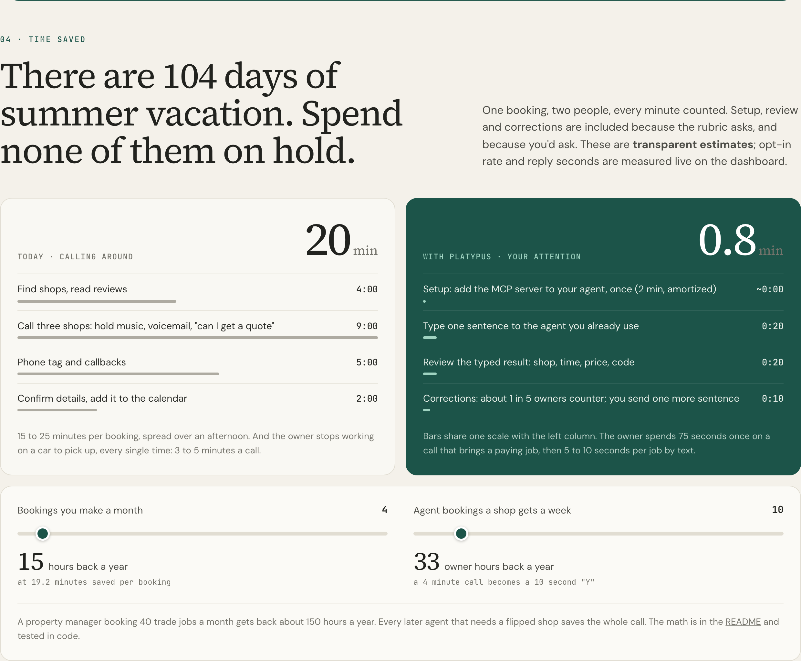

---

## The moat: consent compounds, calls don't

Every agent that calls a business starts from zero, and the next agent calls it again. Every yes Platypus collects is supply that no other agent can reach without making that call itself.

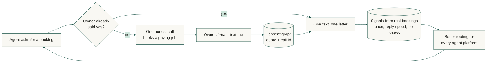

1. **The consent graph.** Each yes is stored with the owner's own words and the call it came from. It's an asset, not a log line.
2. **Signals only real bookings create.** What a business actually charges, how fast it replies, whether it shows up. Nothing to game.
3. **Neutral by design.** Muse, Dots, Claude and Instinct can all route through the same supply instead of each re-calling the same shop.
4. **The owner's relationship.** We text owners work, not leads, and charge only when a job is confirmed.

| Category | Examples | What they do | Why Platypus is different |
| --- | --- | --- | --- |
| Personal agents that call | Muse, Instinct Concierge, Google Ask for Me | Call a business for one task, every time. Nothing persists. | Calls once to onboard, then texts. Neutral supply for all of them. |
| AI receptionists | Rosie, Yelp Host | Answer human calls for the business. | Serve the agents calling in, through open standards. |
| Marketplaces | Yelp, Thumbtack, Angi | Own discovery; gate or charge agents. | Open to every agent; the business keeps its customer. |
| Agent commerce standards | PAP, UCP, ACP, Visa TAP | Identity and checkout for businesses with systems. | The adapter for every business without a site, an API or an agent. |
| Booking software | ServiceTitan, Jobber, Calendly | Great for businesses that adopt software. | The ones that never will. |

Google's call is a lookup. Ours is onboarding.

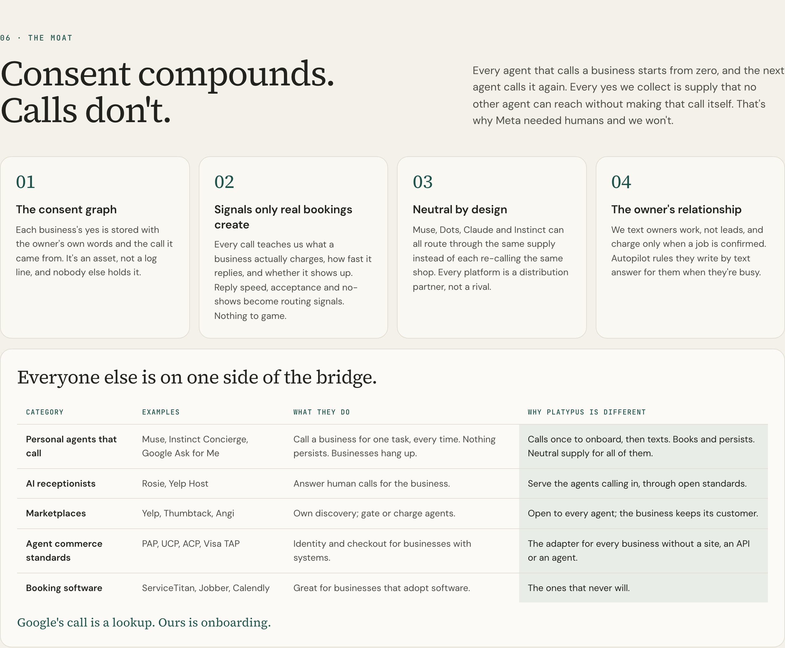

---

## Run it in two minutes

You need Node 22.12 or newer and pnpm 10.

```bash
pnpm install
cp .env.example .env      # fakes mode needs nothing else
pnpm dev                  # events on :8787, dashboard on http://localhost:5173
```

With `DEMO_MODE=fakes` (the default), `pnpm dev` starts from an empty event log and replays the golden path into the dashboard at twice its real pacing. Press **Watch the golden path** to see it again. No Dial, Darwin or Anthropic key is needed.

| Command | What it does |
| --- | --- |
| `pnpm dev` | Event server, gateway and dashboard, plus a golden-path replay in fakes mode |
| `pnpm --filter @platypus/gateway demo:cli oil` | Drives the golden path over MCP from the terminal, as any agent would |
| `pnpm check` | Lint, typecheck and every test (also what CI runs) |
| `pnpm run doctor` | Checks `.env` without printing secrets, checks live Darwin, and runs `dial doctor` if the Dial CLI is installed |
| `pnpm darwin:smoke` | Runs the live Darwin search ladder for all six seeded businesses |
| `pnpm db:seed` | Creates the six businesses; Sal's Auto takes its real number from `ALLOWED_NUMBERS[0]` |
| `pnpm fixtures:golden-path` | Re-records the golden-path fixture by running the whole demo against the fakes |
| `pnpm contracts:export` | Writes every contract as JSON Schema to `packages/shared/schemas/` |

---

## Architecture

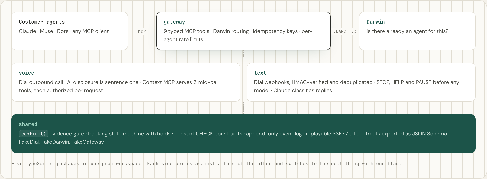

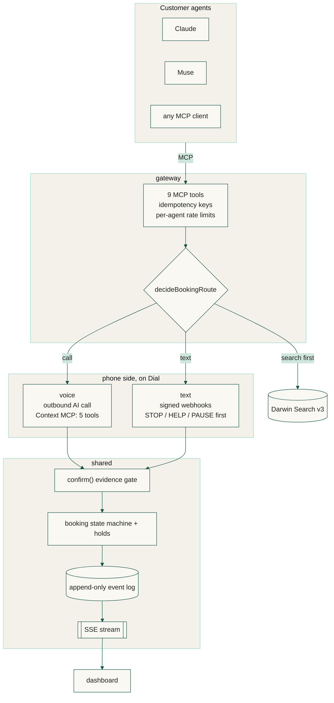

### How a request is routed

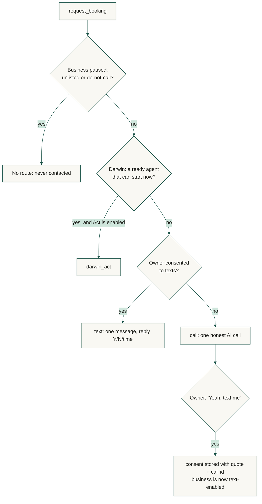

### The booking state machine

`confirmed` can be entered only through `confirm()`, and only from the states below that allow it. `transition()` refuses it outright. This diagram is [`TRANSITIONS`](packages/shared/src/booking/machine.ts), drawn.

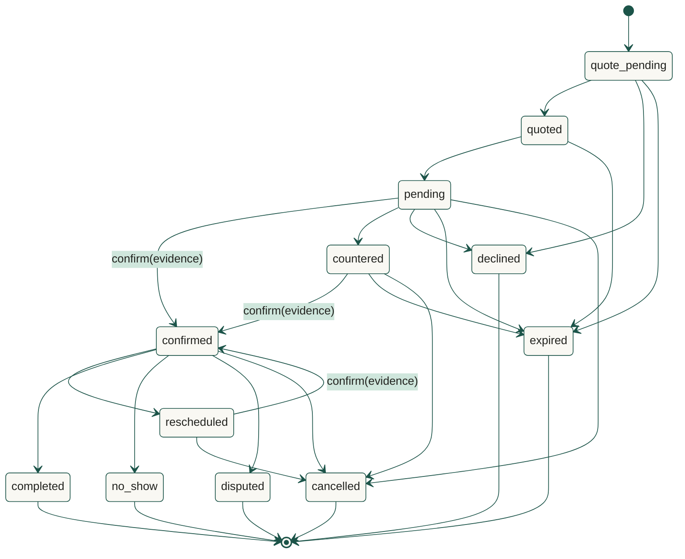

| Package | What it owns |
| --- | --- |
| [`shared`](packages/shared) | Everything the other packages agree on. **contracts**: Zod schemas for the nine gateway tools, the five mid-call voice tools, texts in and out, routing signals and reply classification, exported as JSON Schema. **db**: SQLite through better-sqlite3, in plain SQL that also runs on Postgres. **events**: the append-only log and an SSE stream that replays from any event id. **booking**: the state machine. **darwin**: the Search v3 client and search ladder. **testing**: FakeDial, FakeGateway, FakeDarwin and the golden-path fixture. |
| [`gateway`](packages/gateway) | The MCP server customer agents talk to (streamable HTTP and stdio), Darwin routing, local routing signals, and the `request_booking` route decision. |
| [`voice`](packages/voice) | Dial outbound calls, with the disclosure hard-coded as the first sentence, and the Context MCP server that exposes the booking tools during the call. |
| [`text`](packages/text) | Owner messages on iMessage, WhatsApp or Dial: signed webhooks, deduplication, STOP/HELP/PAUSE handled before any model call, and reply classification. |
| [`dashboard`](packages/dashboard) | The public page and live view of the event log. Deployed to [tryplatypus.pages.dev](https://tryplatypus.pages.dev) on every push to `main`; with no server behind it, it replays the recorded golden path. |

**Gateway tools (MCP):** `search_providers`, `get_provider`, `get_availability`, `request_booking`, `get_booking`, `confirm_booking`, `cancel_booking`, `reschedule_booking`, `report_outcome`.
**Mid-call voice tools (Dial Context MCP):** `check_slot`, `hold_slot`, `create_booking`, `record_consent`, `set_text_number`.

---

## Guarantees the code enforces

> A model saying "booked" is not evidence. Curse you, Hallucinat-inator!

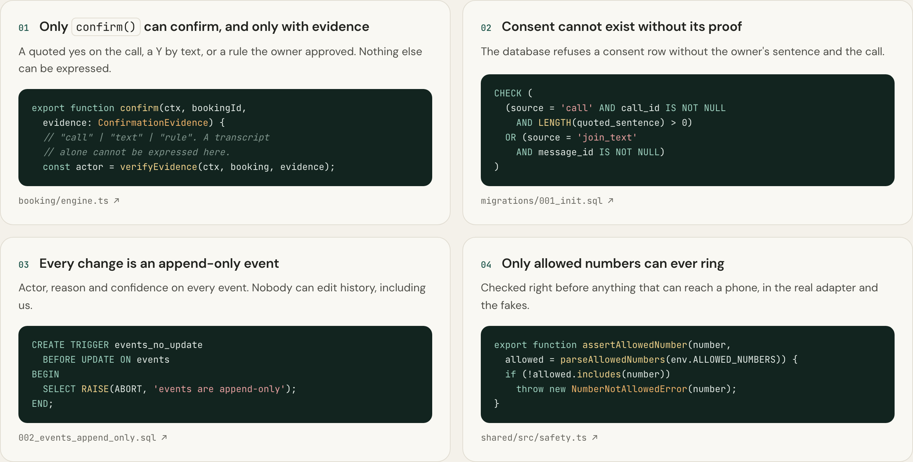

- **A booking is confirmed only when the owner says yes.** `confirm(bookingId, evidence)` is the only function that can set `confirmed`, and `transition()` refuses that status outright. It accepts three kinds of evidence:
  - a call where the booking was made through `hold_slot` and `create_booking` and the owner's words are quoted;
  - an inbound text classified as a yes;
  - an autopilot rule the owner confirmed by text.

  A transcript alone, or a model saying "booked", cannot be expressed as evidence.
- **Consent needs its proof.** A `CHECK` constraint refuses a consent row without the quoted sentence and call id, or without the JOIN message.
- **Every state change is an event** with an actor (agent, owner, autopilot, voice or system), a reason and a confidence. Database triggers make the log append-only, and events are published only after their transaction commits.
- **Only allowed numbers are reachable.** `assertAllowedNumber` runs immediately before anything that can ring or text a phone, including the fakes.
- **No SMS to regular phones yet.** `TEXT_CHANNEL` accepts `imessage`, `whatsapp` or `dial`, never `sms`, because SMS to regular phones needs 10DLC registration, which comes after the event.
- **Agent and owner text is data, not instructions.** It has links stripped, is capped in length, and is rendered as text, never as HTML.
- **Mid-call tools are authorized on every request.** Each request must come from the number on the live call and name that call's business.
- **Darwin is never simulated in live mode.** If it is down, the step is skipped and the log says so.

---

## Partner integrations

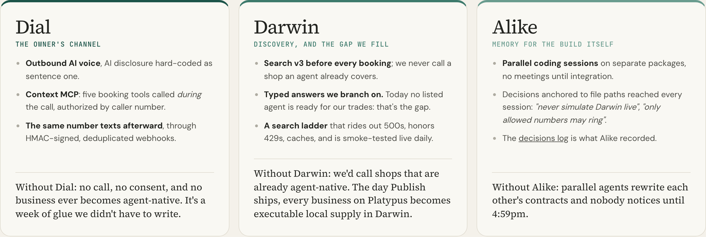

The deepest use of Dial and Darwin in the room: most teams will place a call; we let the call book through our tools and collect consent through our tools. Most teams will search Darwin; we show where its coverage ends and fill the gap. We removed a fourth partner integration during the event because it wasn't doing real work.

### Best use of Dial: the phone, both directions

| What | How Platypus uses it |
| --- | --- |
| Outbound AI voice | One call per business, ever. The AI disclosure is hard-coded as the first sentence, not left to a prompt. |
| Context MCP | The voice agent calls our booking tools *during the conversation*: `check_slot`, `hold_slot`, `create_booking`, `record_consent`, `set_text_number`. Each request is authorized against the live call's number and business. |
| Messaging rail | Owner texts over iMessage, WhatsApp or Dial-to-Dial, with `X-Dial-Signature` HMAC verification and `X-Dial-Event-ID` deduplication. |
| Contracts | Request and webhook shapes checked against Dial's OpenAPI spec and SDK types; FakeDial enforces the same limits, including the allowlist. |

**Without Dial:** no call, no consent, and no business ever becomes agent-native.

### Best use of Darwin: check the agentic web first

| What | How Platypus uses it |
| --- | --- |
| Search v3 before every booking | Trade and service, with budget and deadline as context. We never phone a business that an agent already covers. |
| A search ladder | Specific query once, then the bare trade twice. It rides out Darwin's HTTP 500s, retries 429 with `Retry-After`, caches for ten minutes, and records the `x-request-id` of every failure. |
| Act | `darwin_act` is chosen only when Darwin reports a ready agent that can start a thread and Act is enabled. |
| Honesty | Responses in the fakes are recorded from the live API with provenance. Darwin is never simulated in live mode. A daily workflow runs the live ladder for all six seeded businesses. |

**Without Darwin:** we would call shops that are already agent-native. Darwin shows where the agentic web ends; Platypus extends it. The day Publish ships, every business on Platypus becomes executable local supply in Darwin. Details are in [docs/darwin.md](docs/darwin.md).

### Best use of Alike: how a team shipped one product in parallel

| What | How Platypus uses it |
| --- | --- |
| Parallel sessions | The team built the phone side and the agent side in separate Claude Code sessions, with no meetings until integration. |
| Decisions anchored to files | The seams between the two sides are recorded as Alike decisions with path anchors. When a session touches a governed file, the other side's decision shows up in that session. |
| Real examples | *"Never use simulated Darwin responses in live demos"*, *"Only allowed numbers may ring"* and *"Keep location text out of Darwin queries"* reached other sessions this way, so nobody undid the confirmation rule or the Darwin cut rule. |
| Public record | Every decision is written up in [DECISIONS.md](DECISIONS.md) for readers outside the team. The process is in [docs/workstreams.md](docs/workstreams.md). |

**Without Alike:** two agents rewrite each other's contracts and nobody notices until 4:59pm.

**Claude** handles reply understanding, transcript mining, and the agent side of the demo.

---

## Business model and path forward

**We sell to the owner. Agents bring the customers.** 33 million US small businesses, and most will never build an API. All of them have a phone. Home services first, then clinics, auto shops, salons, movers: anything with a phone.

| Revenue line | How it works |
| --- | --- |
| Per confirmed booking | Owners already pay per lead on marketplaces. We charge only for real, confirmed jobs. |
| Autopilot subscription | The front office as software: rules by text (*"oil changes Tuesday to Thursday under $100, auto-yes"*), live availability, instant quotes, crew dispatch. |
| Platform access | Agent platforms pay for routing signals, volume and response SLAs. They can't onboard millions of phone-only businesses one by one. |

Pricing is a hypothesis to test with the first ten owners. **Why now:** demand arrived in September, the agent protocol spec lands at the end of October, and Dial and Darwin just became real infrastructure. Supply is up for grabs for a few months.

**Next, in order:**

1. The live Dial call and owner texts, end to end.
2. Ten real owners called on Monday; opt-in rate is the number we live on.
3. SMS to regular phones after 10DLC registration through Dial.
4. Autopilot rules, then a Personal Agent Protocol adapter when v0.1 lands.
5. Darwin Publish: every flipped business becomes executable local supply.

**Risks we say out loud:**

- *Owners hang up on AI.* We only need one call to work, and it brings a paying job. We ask after the booking; after a yes they never hear an AI voice again.
- *Platforms may build this.* Meta's human-concierge test shows how hard calls are at scale. We stay neutral so platforms use us instead of rebuilding supply city by city.
- *AI calls carry stricter rules.* Published business lines only, AI disclosed first, "don't call again" honored instantly, texts only after a recorded yes. Counsel before scale.
- *The owner says no to texting.* We book the job anyway and log the no. Three no's and we stop asking for 90 days.

> Businesses live on the phone. Agents live online. **Platypus lives in both.**

## For agents and developers

The site is built to be read by agents as well as people.

- [`/llms.txt`](https://tryplatypus.pages.dev/llms.txt) says what Platypus is and **when to use it**, in the [llmstxt.org](https://llmstxt.org) format.
- Every page answers `Accept: text/markdown` with Markdown and `Vary: Accept` ([acceptmarkdown.com](https://acceptmarkdown.com)); `/index.md`, `/developers.md` and the others work directly.
- Unknown paths return a real `404`, with a Markdown body that points to `llms.txt`, the developer guide and the sitemap.
- [`/developers`](https://tryplatypus.pages.dev/developers) is the developer guide: sandbox quickstart, the MCP endpoint and headers, all nine tools, outcomes and keys. [`/about`](https://tryplatypus.pages.dev/about), [`/contact`](https://tryplatypus.pages.dev/contact) and [`/privacy`](https://tryplatypus.pages.dev/privacy) are written once in Markdown and rendered at build time.

```bash
curl -sS -i -H 'Accept: text/markdown' https://tryplatypus.pages.dev/
curl -sS -i -H 'Accept: text/markdown' https://tryplatypus.pages.dev/some-path-that-does-not-exist
```

---

## What is real today and what is mocked

| Real | Mocked or not yet built |
| --- | --- |
| The shared foundation: contracts, booking state machine, holds, consent rules, event log, SSE stream, CI | Sal's Auto is not a real business. Its phone belongs to a teammate, Karthik, who is not a mechanic. |
| The gateway's nine MCP tools over streamable HTTP and stdio, routing, and the demo CLI | FakeDial plays the scripted demo call for development. The live Dial call is built on the phone side. |
| Dial API shapes in the contracts and fakes, checked against Dial's OpenAPI spec and SDK on 2026-10-11 | Darwin has not yet returned a `no_match` for the demo query; it returns listed agents, none ready. The only `no_match` in the repo is a test double labeled SYNTHETIC; it refuses to run in live mode and never appears in the fixture or on the dashboard. |
| The live Darwin Search v3 client, search ladder and daily smoke check; fake responses are recorded from the live API | Texts to regular phones need 10DLC, which is filed after the event. Today's rail is iMessage, WhatsApp, or a second Dial number. |
| The golden-path fixture is generated by running the whole demo against the fakes through the real state machine | Five of the six seeded businesses use 555-01xx numbers, which are reserved for fiction. |
| The public site's Markdown negotiation, 404s and pages, verified on the Pages runtime with `wrangler pages dev` | Time saved is an **estimate**, with every assumption listed in [Time saved](#time-saved). |

This table is updated as each side lands.

## How it is being built

One foundation, then two sides in parallel: the **phone side** (`voice` and `text`: the Dial call, the mid-call tools, owner texts) and the **agent side** (`gateway`: MCP tools, Darwin, routing, plus the demo video and submission). Each side builds against fakes of the other and switches to the real thing with one flag. Ownership, exit criteria and flags are in [docs/workstreams.md](docs/workstreams.md).

## Repository map

| Path | What lives there |
| --- | --- |
| [`packages/shared`](packages/shared) | Contracts, database migrations, events, booking engine, Darwin client, fakes and fixtures, exported JSON Schemas |
| [`packages/gateway`](packages/gateway) | The MCP server, routing and the demo CLI |
| [`packages/voice`](packages/voice) | Dial calls and the Context MCP server |
| [`packages/text`](packages/text) | Owner messaging |
| [`packages/dashboard`](packages/dashboard) | The public site: landing page, `/live`, `content/*.md` pages, the `functions/` middleware |
| [`scripts`](scripts) | Dev server, doctor, live mode, Darwin smoke, CI helpers |
| [`docs`](docs) | Workstreams, Darwin, screenshots, pitch deck, video run sheet, submission text |
| [`DECISIONS.md`](DECISIONS.md) | Every decision we made and why, for readers outside the team |

## License

MIT. See [LICENSE](LICENSE).
