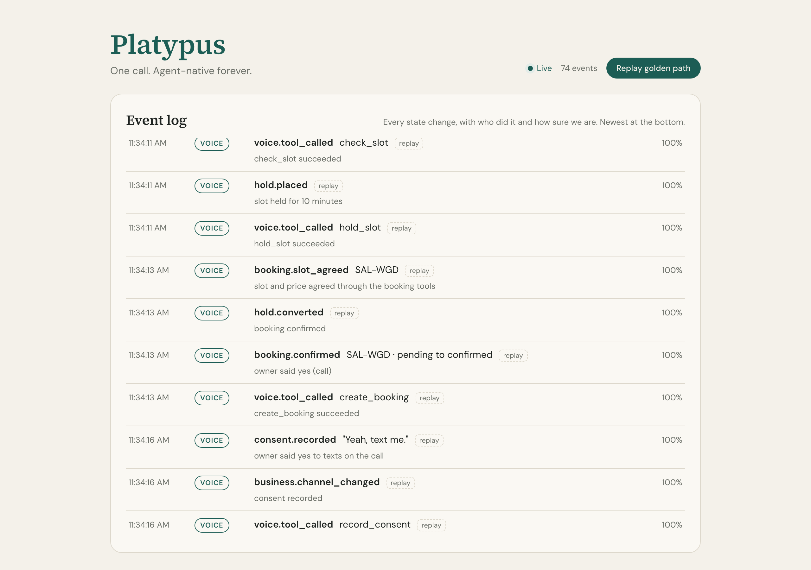

# Platypus — We make Main Street agent-native.

**One call makes any phone-only business bookable by every AI agent. Call once, agent-native forever.**

`ai-agents` · `mcp` · `voice-agents` · `sms` · `local-services` · `dial` · `darwin` · `speedhacks` · `sf-tech-week` · `typescript`


**Live:** [tryplatypus.pages.dev](https://tryplatypus.pages.dev) replays the golden path in your browser.

Your agent can book a flight. It can't book Main Street. Most of the 33 million small businesses in the US will never build an API, a website with a booking widget, or an agent of their own. They have a phone. Platypus meets them there, exactly once.

A customer's agent (Claude, Muse, Dots, Instinct, anything that speaks MCP) calls our MCP tools. We search Darwin for an existing agent that can do the job. If there is none, we place an AI voice call through Dial to the business. The call discloses that it is an AI in its first sentence, gets a price and an opening, and books the job through our own tools while the owner is still on the line. Then it asks one more thing: *"Next time a customer's agent needs you, can I text you instead of calling?"* A yes becomes stored consent, quoted word for word, and from then on that business is bookable by every agent with a text the owner answers in one word.

> One call. Agent-native forever.



## The golden path

This is the demo, and the only thing that must work end to end.

1. In Claude Desktop, a customer types: *"Oil change tomorrow afternoon, under $120, near 1025 Sansome."* Claude calls `search_providers`, then `request_booking`, on the Platypus MCP server.
2. The gateway runs Darwin Search v3 with the budget and deadline as context. When Darwin has no agent that is ready to take the job (for our trades it answers with listed agents, none of them ready), the dashboard shows that gap and its reason, and Platypus goes to the phone.
3. The gateway attaches routing signals for the candidate shop: typical price, median reply time, and acceptance rate.
4. There is no consent on record, so the route is **call**. Dial places an outbound call to Sal's Auto, which today is a teammate's phone. The AI discloses itself, then asks for a price and an opening.
5. During the call, the voice agent calls our tools through Dial's Context MCP: `check_slot`, `hold_slot`, `create_booking`, `record_consent` and `set_text_number`. Each one lights up on the dashboard.
6. The owner says *"Yeah, text me."* Consent is stored with that sentence and the call id, and Sal's card flips from PHONE-ONLY to TEXT-ENABLED.
7. Claude polls `get_booking` and renders a typed result: *Booked: Sal's Auto, tomorrow 2:00pm, $89, SAL-4K2.*
8. Second request: *"Also book a brake inspection there next week."* This time there is no call. The owner's phone gets a text (iMessage, WhatsApp or Dial), the owner replies **Y**, and the booking is confirmed within seconds.
9. The supply table shows six businesses: which are text-enabled, how fast each replies, and the last price.

## Run it in two minutes

You need Node 22.12 or newer and pnpm 10.

```bash
pnpm install
cp .env.example .env      # fakes mode needs nothing else
pnpm dev                  # events on :8787, dashboard on http://localhost:5173
```

With `DEMO_MODE=fakes` (the default), `pnpm dev` starts from an empty event log and replays the golden path into the dashboard at twice its real pacing. Press **Replay golden path** to watch it again. No Dial, Darwin or Anthropic key is needed.

| Command | What it does |
| --- | --- |
| `pnpm dev` | Event server and dashboard, plus a golden-path replay in fakes mode |
| `pnpm check` | Lint, typecheck and every test (also what CI runs) |
| `pnpm run doctor` | Checks `.env` without printing secrets, and runs `dial doctor` if the Dial CLI is installed |
| `pnpm db:seed` | Creates the six businesses; Sal's Auto takes its real number from `ALLOWED_NUMBERS[0]` |
| `pnpm fixtures:golden-path` | Re-records the golden-path fixture by running the whole demo against the fakes |
| `pnpm contracts:export` | Writes every contract as JSON Schema to `packages/shared/schemas/` |

## Architecture

```
 Customer agents (Claude, Muse, Dots, Instinct)          Darwin (agent search)
                 │  MCP                                         ▲
                 ▼                                              │
 ┌──────────────────────────── gateway ────────────────────────┴──────┐
 │ GatewayTools over MCP · Darwin Search v3 · route: darwin_act/call/text │
 │ routing signals · idempotency keys · per-agent rate limits             │
 └───────────────┬──────────────────────────────────────┬────────────────┘
                 │                                      │
     ┌───────────▼───────────┐              ┌───────────▼───────────┐
     │ voice                 │              │ text                  │
     │ Dial outbound call    │              │ Dial webhooks + stream│
     │ Context MCP server    │              │ STOP/HELP/PAUSE first │
     │ (VoiceTools mid-call) │              │ reply understanding   │
     └───────────┬───────────┘              └───────────┬───────────┘
                 └──────────────┬───────────────────────┘
                                ▼
 ┌──────────────────────────── shared ──────────────────────────────────┐
 │ contracts (Zod + JSON Schema) · booking state machine · confirm()    │
 │ SQLite with portable SQL · append-only event log · SSE stream · fakes│
 └───────────────────────────────┬──────────────────────────────────────┘
                                 ▼
                    dashboard (Vite, /events/stream)
```

| Package | What it owns |
| --- | --- |
| [`shared`](packages/shared) | Everything the other packages agree on. **contracts**: Zod schemas for the nine gateway tools, the five mid-call voice tools, texts in and out, routing signals and reply classification, exported as JSON Schema. **db**: SQLite through better-sqlite3, in plain SQL that also runs on Postgres. **events**: the append-only log and an SSE stream that replays from any event id. **booking**: the state machine. **testing**: FakeDial, FakeGateway, FakeDarwin and the golden-path fixture. |
| [`gateway`](packages/gateway) | The MCP server customer agents talk to, Darwin routing, and the `request_booking` route decision. |
| [`voice`](packages/voice) | Dial outbound calls, with the disclosure hard-coded as the first sentence, and the Context MCP server that exposes the booking tools during the call. |
| [`text`](packages/text) | Owner messages on iMessage, WhatsApp or Dial: signed webhooks, deduplication, STOP/HELP/PAUSE handled before any model call, and reply classification. |
| [`dashboard`](packages/dashboard) | The live view of the event log. Deployed to [tryplatypus.pages.dev](https://tryplatypus.pages.dev) on every push to `main`; with no server behind it, it replays the recorded golden path. |

### The rules the code enforces

- **A booking is confirmed only when the owner says yes.** `confirm(bookingId, evidence)` is the only function that can set `confirmed`, and `transition()` refuses that status outright. It accepts three kinds of evidence:
  - a call where the booking was made through `hold_slot` and `create_booking` and the owner's words are quoted;
  - an inbound text classified as a yes;
  - an autopilot rule the owner confirmed by text.

  A transcript alone, or a model saying "booked", cannot be expressed as evidence.
- **Consent needs its proof.** The schema itself refuses a consent row without the quoted sentence and call id, or without the JOIN message.
- **Every state change is an event** with an actor (agent, owner, autopilot, voice or system), a reason and a confidence. A database trigger makes the log append-only, and events are published only after their transaction commits.
- **Only allowed numbers are reachable.** `assertAllowedNumber` runs immediately before anything that can ring or text a phone, including the fakes.
- **No SMS to regular phones yet.** `TEXT_CHANNEL` accepts `imessage`, `whatsapp` or `dial`, never `sms`, because SMS to regular phones needs 10DLC registration, which comes after the event.
- **Agent and owner text is data, not instructions.** It has links stripped, is capped in length, and is rendered as text, never as HTML.
- **Mid-call tools are authorized on every request.** Each request must come from the number on the live call and name that call's business.

## What is real today and what is mocked

| Real | Mocked or not yet built |
| --- | --- |
| The shared foundation: contracts, booking state machine, holds, consent rules, event log, SSE stream, CI | Sal's Auto is not a real business. Its phone belongs to a teammate, Karthik, who is not a mechanic. |
| Dial API shapes in the contracts and fakes, checked against Dial's OpenAPI spec and SDK on 2026-10-11 | FakeDial plays the scripted demo call for development. The live Dial call is built on the phone side. |
| Darwin responses in the fakes are recorded from the live API: a completed search, and the HTTP 500 the demo query returned on 2026-10-11 | Darwin has not yet returned a `no_match` for the demo query. The only `no_match` in the repo is a test double labeled SYNTHETIC; it refuses to run in live mode and never appears in the fixture or on the dashboard. |
| The golden-path fixture is generated by running the whole demo against the fakes through the real state machine | Texts to regular phones need 10DLC, which is filed after the event. Today's rail is iMessage, WhatsApp, or a second Dial number. |
| | Five of the six seeded businesses use 555-01xx numbers, which are reserved for fiction. |
| | Time saved is an **estimate**: about 15 to 25 minutes of calling around per booking today, under a minute with Platypus, and 75 seconds once for the owner. |

This table is updated as each side lands.

## How it is being built

One foundation, then two sides in parallel: the **phone side** (`voice` and `text`: the Dial call, the mid-call tools, owner texts) and the **agent side** (`gateway`: MCP tools, Darwin, routing, plus the demo video and submission). Each side builds against fakes of the other and switches to the real thing with one flag. Ownership, exit criteria and flags are in [docs/workstreams.md](docs/workstreams.md).

## Partner tools

- **[Dial](https://getdial.ai)** provides the voice calls, the Context MCP integration that lets the voice agent book mid-call, and the owner text rail (iMessage, WhatsApp or Dial-to-Dial).
- **[Darwin](https://darwin.so)** runs Search v3 before any call, so we never phone a business an existing agent already covers. When no listed agent is ready to act, that gap shows where the agentic web stops today.
- **[Alike](https://alike.help)** gives the team shared memory across its parallel coding sessions. It briefs each session with the others' decisions, which are recorded in [DECISIONS.md](DECISIONS.md).
- **Claude** handles reply understanding, transcript mining, and the agent side of the demo.

## Repository map

```
packages/
  shared/      contracts, db (migrations/*.sql), events, booking, testing (fakes + fixtures), schemas/
  gateway/     MCP server and routing
  voice/       Dial calls and the Context MCP server
  text/        owner messaging
  dashboard/   Vite dashboard
scripts/       dev server, doctor
docs/          workstreams, screenshots, video shot list, submission text
DECISIONS.md   every decision we made and why, for readers outside the team
```

## License

MIT. See [LICENSE](LICENSE).
