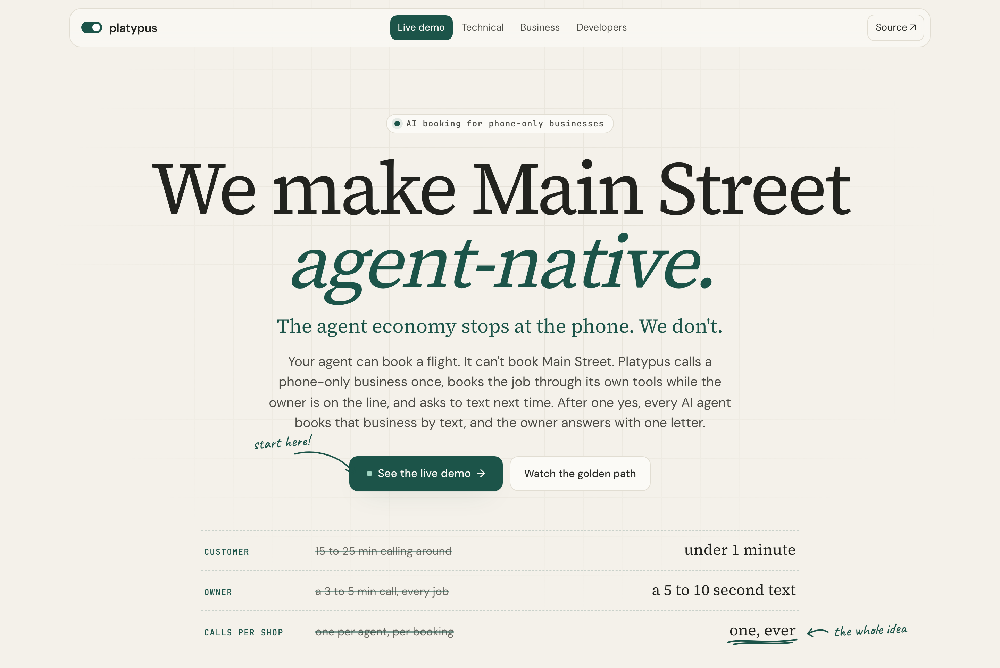
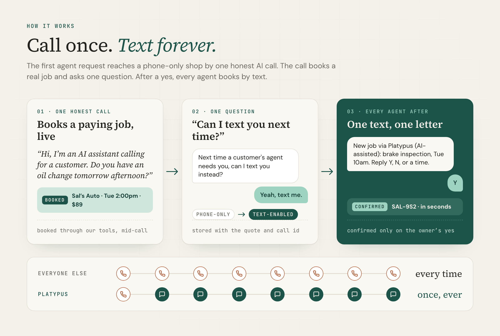
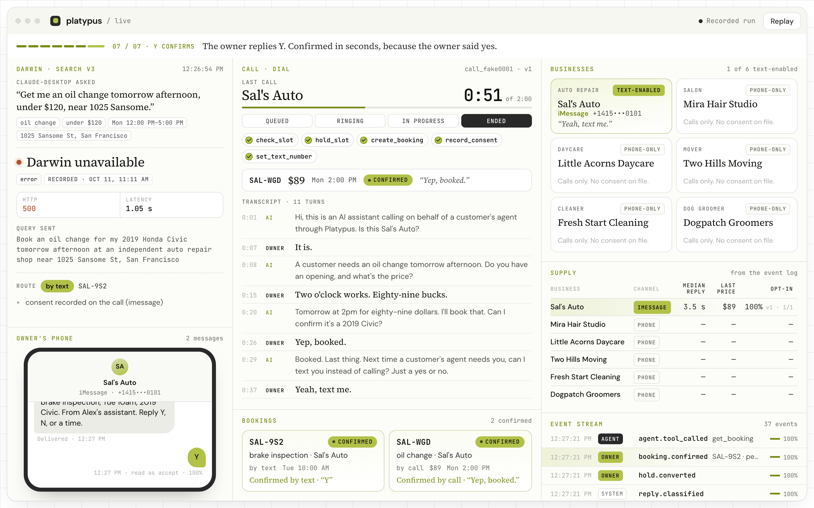
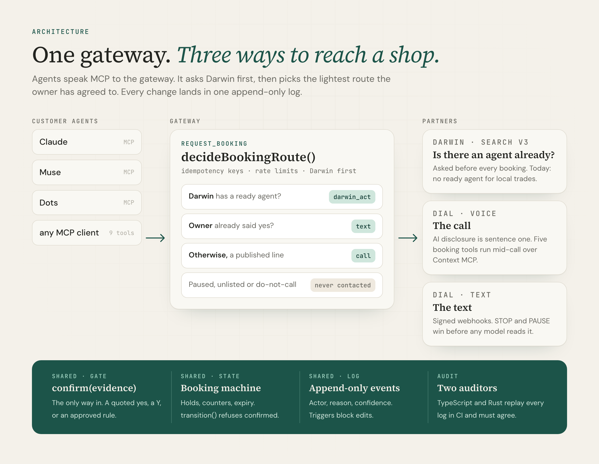

# Platypus

**We make Main Street agent-native.** One honest AI call makes a phone-only business bookable by every AI agent, by text, forever.

  

**[tryplatypus.pages.dev](https://tryplatypus.pages.dev)** · **[Watch the demo run](https://tryplatypus.pages.dev/live)** · **[For agents](https://tryplatypus.pages.dev/developers)**



Most of the 33 million US small businesses will never build an API. They have a phone. Every personal agent that "calls for you" calls the same shop again for every booking. **We call once.** The call books a real, paying job, then asks the owner one question: *"Next time a customer's agent needs you, can I text you instead?"* After a yes, every agent books that shop by text, and the owner answers with one letter.

| Judged on | Where to look |
| --- | --- |
| Time saved (40%) | [Time saved](#time-saved): about 20 minutes of calling around becomes under a minute, and a 4 minute call becomes a 10 second text |
| Technical execution (25%) | [The AI can't fake a booking](#the-ai-cant-fake-a-booking), and `pnpm verify`, which runs every check with no keys |
| Market and path (15%) | [Why it wins](#why-it-wins) |
| Originality (10%) | The call *is* the onboarding: it books a paying job and converts the shop in the same 75 seconds |
| Product and demo (10%) | [The demo](#the-demo), and [/live](https://tryplatypus.pages.dev/live) in your browser |
| Dial, Darwin, Alike | [Built on Dial and Darwin](#built-on-dial-and-darwin): what each one does here and what breaks without it |

Agents evaluating this repo should start at [AGENTS.md](AGENTS.md).

---

## How it works



## The demo

An oil change turns Eddy's Auto agent-native. The next booking, a brake inspection, goes by text and is confirmed in 4 seconds.



Run it yourself at [/live](https://tryplatypus.pages.dev/live), or locally with no keys (see [Run it](#run-it)).

---

## Built on Dial and Darwin

Platypus is a thin layer of trust between two great tools. Dial gives an AI a real phone. Darwin tells every agent what already exists. Put them together and a business with nothing but a phone line becomes something any agent can book.

### Dial: the whole phone side, in one platform

Dial is the reason a one-call onboarding is possible at all. Without Dial, this would have taken a telephony vendor, a speech stack, an SMS provider and a week of glue code.

- **A real AI voice call** through `POST /v1/calls`, which opens with *"Hi, I'm an AI assistant calling for a customer"*. The disclosure is hard-coded as the first sentence.
- **Context MCP is the killer feature.** Dial's voice agent calls our booking tools *during* the call: `check_slot`, `hold_slot`, `create_booking`, `record_consent` and `set_text_number`. The job is held and booked while the owner is still talking, through the same state machine the rest of the system uses, and each tool call is authorized against the live call. No other voice platform we know makes this so direct.
- **One number for calls and texts.** The number that called the owner is the number that texts them next time, over iMessage, WhatsApp or SMS. To the owner it is one contact, which is why they say yes.
- **Signed webhooks** (`X-Dial-Signature`, HMAC-SHA256) and per-event dedupe make inbound replies safe to act on.
- **It works on real phones today.** In the demo, Dial places a real AI call to a real phone, the tools book the job mid-call, and the owner answers a real iMessage with Y.

*Without Dial there is no call and no consent, so no shop ever becomes agent-native.* Integration is in [`packages/voice`](packages/voice) and [`packages/text`](packages/text). The request shapes were checked against Dial's OpenAPI spec and SDK.

### Darwin: the map of what agents can already do

Darwin is the search engine agents use to find other agents, and Platypus asks it before every booking. That one question keeps Platypus honest: we only phone a business when no agent can already do the job.

- **Search v3 before every call**, with the trade, service, area, budget and deadline as context. For the demo's oil change, Darwin answers `no_match` in about a second. Platypus treats that as a fact and routes to a call.
- **Darwin's answer is what proves the market.** Across all six seeded trades, it finds no agent that can take the job. Darwin turns "local services aren't agent-ready" from a pitch line into a measured result, and every response we show is [recorded, never simulated](docs/darwin.md).
- **Ready for the handoff.** When Darwin lists an agent that can start a thread, and an Act credential is configured, the router picks `darwin_act` and hands the job to it through Darwin Act. Platypus never competes with a real agent.
- **Darwin's MCP server is in this repo's [`.mcp.json`](.mcp.json)**, so every coding session here sees the same `search` tool customer agents use.
- **The future is Darwin Publish.** Each shop Platypus converts becomes supply an agent can execute. Publishing those shops to Darwin makes every one discoverable by every agent at once.

*Without Darwin we would call shops that agents can already book, and we couldn't show the gap is real.* Integration is in [`packages/shared/src/darwin`](packages/shared/src/darwin).

### Alike: memory for the build

The phone side and the agent side were built in parallel coding sessions. Alike anchored decisions to file paths and carried them into every session, so no session undid the confirmation rule, the number allowlist or the Darwin rules. [DECISIONS.md](DECISIONS.md) is what Alike recorded.

---

## Time saved

| | Today | With Platypus |
| --- | ---: | ---: |
| **Customer**, per booking | 15 to 25 min of calling around and phone tag | **under 1 min**: one sentence, then review the result |
| **Owner**, per job | a 3 to 5 min call, mid-job | **a 5 to 10 s text** after one 75 s call |
| **Calls per shop** | one per agent, per booking | **one, ever** |

These are estimates that count setup, review and corrections (about one owner in five counters the first offer). At four bookings a month, a customer gets back about 15 hours a year. A property manager booking 40 jobs a month gets back about 150. The math is in [`format.ts`](packages/dashboard/src/format.ts), with tests.

---

## The AI can't fake a booking

The architecture is built so that a booking is never confirmed just because a model said so.

- **Only `confirm()` can confirm, and only with evidence:** a quoted yes on a call where the slot was held, a text classified as yes, or a rule the owner approved. A transcript alone can't be passed in as evidence.
- **Consent needs proof.** A database `CHECK` refuses a consent row that lacks the owner's sentence and the call id.
- **History is append-only.** Every change is an event with an actor, a reason and a confidence, and database triggers block edits.
- **Only allowlisted numbers can ring.** The check runs right before any network request, including in the fakes.

**Two auditors check every log.** One is in TypeScript and the other was written independently in Rust ([`crates/platypus-audit`](crates/platypus-audit/README.md)). Both replay the event log against eight rules, and `pnpm verify` fails if they disagree on any of more than 1,600 logs.



| Package | Owns |
| --- | --- |
| [`gateway`](packages/gateway) | The MCP server agents call (ten tools), the Darwin lookup and the route decision |
| [`voice`](packages/voice) | Dial outbound calls with the AI disclosure first, and the Context MCP server for the five mid-call tools |
| [`text`](packages/text) | Owner texts: signed webhooks, STOP and PAUSE handled before any model, reply classification |
| [`shared`](packages/shared) | Zod contracts, SQLite, the event log and SSE stream, the booking state machine, the fakes |
| [`dashboard`](packages/dashboard) | The site and the `/live` operator view, on Cloudflare Pages |

---

## Why it wins

- **Timing.** In one month, every lab shipped a personal agent that makes phone calls (Muse, Instinct, Dots). None of them remembers a business between tasks, and businesses hang up on repeated AI calls.
- **It compounds.** Every yes is stored in the owner's own words. Every booking adds signals no one else has: real prices, reply speed and no-shows. Those signals improve routing for every agent platform.
- **Neutral supply.** Any MCP client books through the same shops, so no platform has to re-call Main Street city by city.
- **Paid on outcomes.** Owners pay per confirmed job, which they already do for leads. The next step after that is an autopilot subscription. The first ten owners get called on Monday, and the opt-in rate is the number we track.

---

## Real vs mocked

- **Real:** a live Dial AI call to a real phone that books through our tools mid-call, stores consent in the owner's own words, then sends a real iMessage that gets a real Y. Also real: the contracts, state machine, consent rules, event log and both auditors; the ten MCP tools and routing; the live Darwin client, with a daily smoke check; and Dial request shapes, checked against Dial's OpenAPI spec.
- **Mocked:** Eddy's Auto is not a real business. Its line is Karthik's phone, and he is not a mechanic. The other five shops are fictional, and the site's replay runs on fakes. SMS to regular phones waits on 10DLC registration (iMessage is approved). The time-saved figures are estimates.

## Run it

Node 22.12 or newer and pnpm 10. Fakes mode needs no keys.

```bash
pnpm install && cp .env.example .env
pnpm dev                                          # gateway on :8787, site on :5173
pnpm --filter @platypus/gateway demo:cli oil      # drive the golden path over MCP
pnpm verify                                       # every check, ending in a scorecard
```

Agents can read [`/llms.txt`](https://tryplatypus.pages.dev/llms.txt), and every page returns Markdown when asked with `Accept: text/markdown`.

MIT licensed. Built at SpeedHacks in San Francisco on October 11, 2026.
