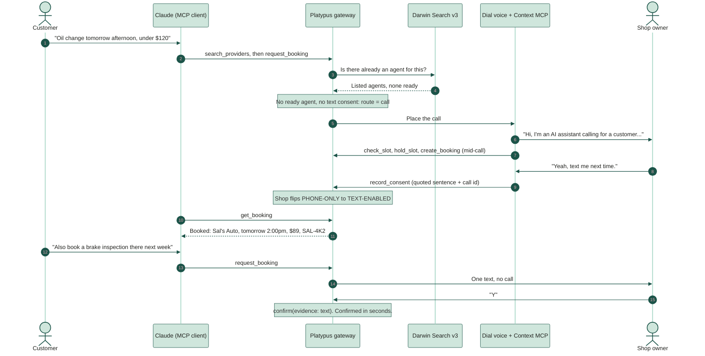
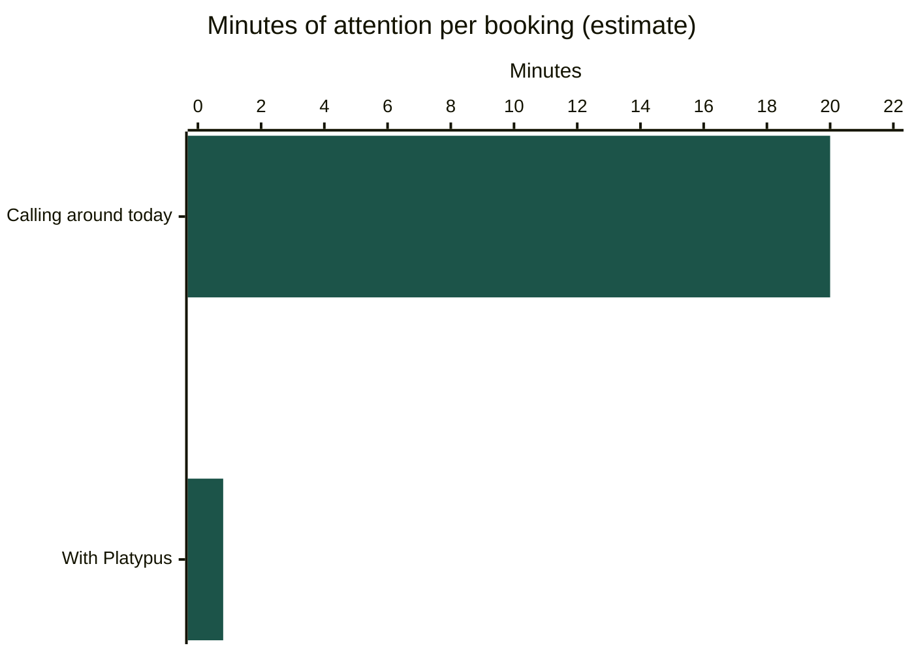
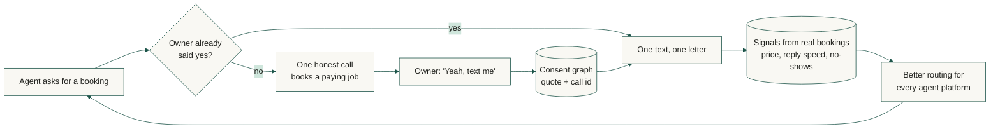
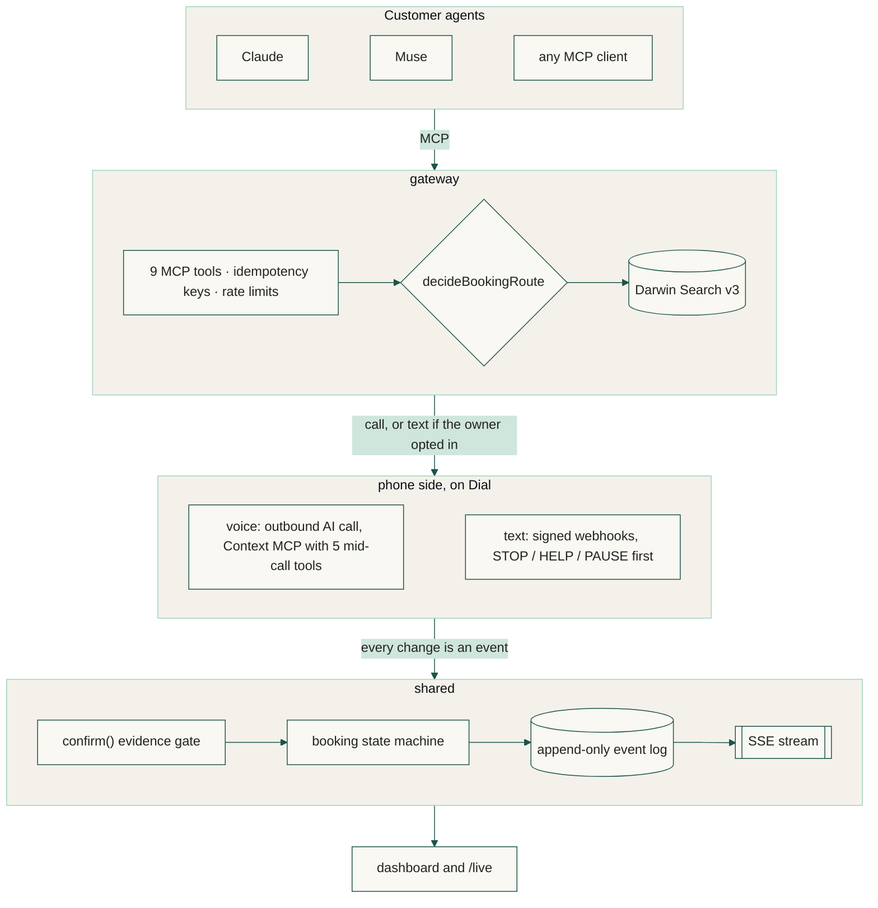
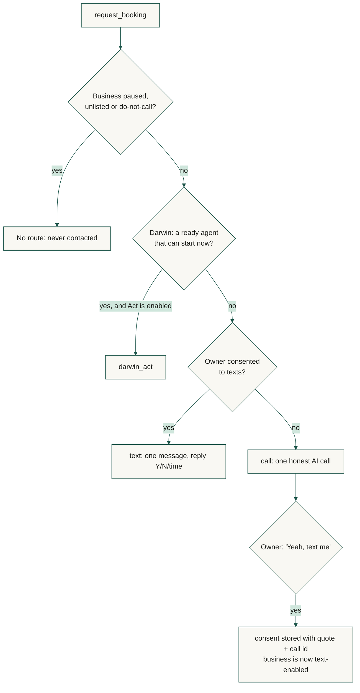
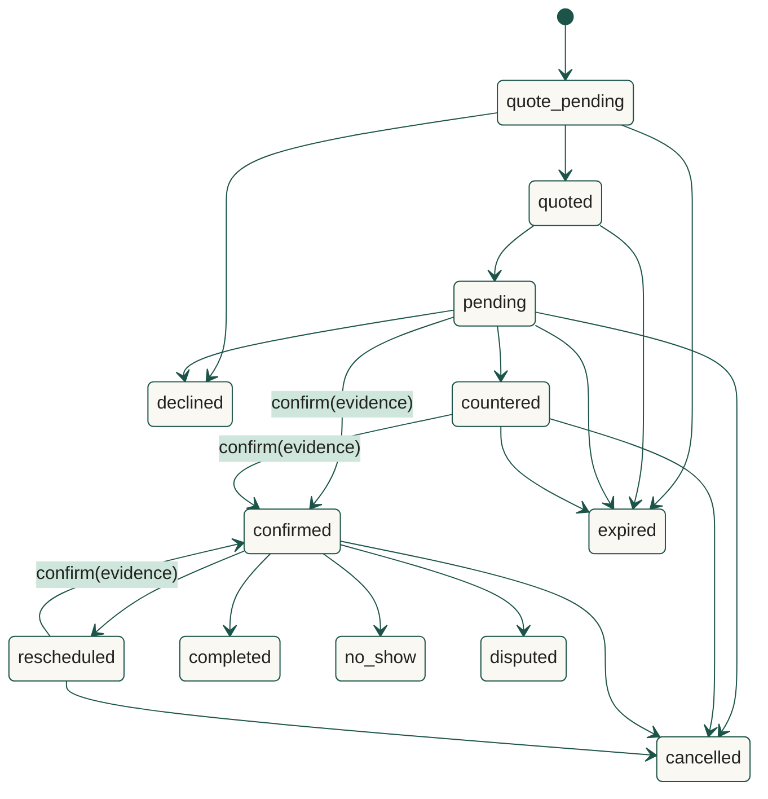

# Platypus: AI booking for phone-only businesses

**We make Main Street agent-native.** One honest AI call makes any phone-only business bookable by every AI agent. Call once, agent-native forever.

[](https://github.com/KarthikSubramanian07/Platypus/actions/workflows/ci.yml) [](https://github.com/KarthikSubramanian07/Platypus/actions/workflows/codeql.yml)   

**Live:** [tryplatypus.pages.dev](https://tryplatypus.pages.dev) replays the demo in your browser. **Operator view:** [tryplatypus.pages.dev/live](https://tryplatypus.pages.dev/live).


Your agent can book a flight. It can't book Main Street. Most of the 33 million US small businesses will never build an API or an agent. They have a phone.

Platypus calls a phone-only business **once**. The call says it's an AI in its first sentence, books a paying job through our own tools while the owner is on the line, and asks: *"Next time a customer's agent needs you, can I text you instead?"* A yes is stored in the owner's own words. From then on, every agent books that business by text, and the owner answers with one letter.

> **Everyone else calls a business every time. We call it once.** Consent compounds; calls don't.

---

## For judges

| Criterion | Weight | Where to look |
| --- | --- | --- |
| **Time saved** | 40% | [Time saved](#time-saved): 15 to 25 minutes of calling around becomes under a minute of attention, setup, review and corrections counted. The owner's 3 to 5 minute call becomes a 5 to 10 second text. |
| **Technical execution** | 25% | [Guarantees](#guarantees-the-code-enforces): an evidence-only `confirm()`, consent the database refuses without proof, an append-only event log, a phone allowlist at the lowest layer. 800 tests, coverage floors, CodeQL and a secret scan on every push. |
| **Market and path** | 15% | [Why it compounds](#why-it-compounds) and [Business model](#business-model-and-whats-next): home services first, owners pay per confirmed job, ten real owners on Monday. |
| **Originality** | 10% | The call is the onboarding, not the product. It books a real job *and* converts the business in the same 75 seconds. Nobody installs anything. |
| **Product and demo** | 10% | [The demo](#the-demo), the [live page](https://tryplatypus.pages.dev), and `pnpm dev` with no keys. |
| **Best use of Dial, Darwin, Alike** | prizes | [Partners](#partners): each one is load-bearing, with what breaks without it. |

---

## The demo

One oil change makes a shop agent-native, then a second booking goes by text.




What's real and what's mocked is in [Real vs mocked](#real-vs-mocked).

---

## Time saved

Transparent estimates, with setup, review and corrections counted. Opt-in rate and reply seconds are measured live on the dashboard.



| | Today | With Platypus |
| --- | ---: | ---: |
| Customer, per booking | 15 to 25 min calling three shops, phone tag, confirming | 0.8 min: one sentence, review the typed result, one correction in five |
| Owner, per job | 3 to 5 min on the phone, mid-job | 5 to 10 s to reply Y, after one 75 s call |
| Calls per shop | one per agent, per booking | one, ever |

Four bookings a month gives a customer back about 15 hours a year; a property manager booking 40 trade jobs a month, about 150. The math is in [`format.ts`](packages/dashboard/src/format.ts), with tests.


---

## Why it compounds



- **The consent graph.** Every yes, in the owner's own words, with the call it came from. Nobody else holds it.
- **Signals only real bookings create.** What a shop really charges, how fast it replies, whether it shows up. Nothing to game.
- **Neutral by design.** Muse, Dots, Claude and Instinct route through the same supply instead of each re-calling the same shop.
- **Jobs, not leads.** Owners pay only for confirmed bookings.

<details>
<summary>Why now, and the landscape</summary>

In one month every lab shipped a personal agent, then added phone calls: Muse (Sep 8), Instinct Concierge (Sep 16), OpenAI Dots (Sep 29), and the Personal Agent Protocol (Oct 6), which only covers businesses with a website, an API or an agent. Businesses hang up on AI calls; Meta put human contractors on Muse's calls for exactly that reason.

| Category | Examples | What they do | Platypus |
| --- | --- | --- | --- |
| Personal agents that call | Muse, Instinct, Google Ask for Me | Call for one task, every time. Nothing persists. | Calls once to onboard, then texts. Neutral supply for all of them. |
| AI receptionists | Rosie, Yelp Host | Answer human calls for the business. | Serves the agents calling in. |
| Marketplaces | Yelp, Thumbtack, Angi | Own discovery; gate or charge agents. | Open to every agent; the business keeps its customer. |
| Agent standards | PAP, UCP, ACP | Businesses with systems. | The adapter for everyone without one. |
| Booking software | ServiceTitan, Jobber | Businesses that adopt software. | The ones that never will. |

Google's call is a lookup. Ours is onboarding.
</details>

---

## How it works



| Package | What it owns |
| --- | --- |
| [`shared`](packages/shared) | Zod contracts (exported as JSON Schema), SQLite with portable SQL, the append-only event log and SSE stream, the booking state machine, the Darwin client, and the fakes |
| [`gateway`](packages/gateway) | The MCP server agents talk to: nine tools, Darwin search, the route decision, a demo CLI |
| [`voice`](packages/voice) | Dial outbound calls with the disclosure hard-coded first, and the Context MCP server for the five mid-call tools |
| [`text`](packages/text) | Owner texts: signed webhooks, STOP/HELP/PAUSE before any model, reply classification |
| [`dashboard`](packages/dashboard) | The public site and the `/live` operator view, deployed to Cloudflare Pages |

<details>
<summary>Routing and the booking state machine</summary>



`confirmed` can be entered only through `confirm()`, with evidence; `transition()` refuses it. `completed`, `no_show`, `disputed`, `declined`, `expired` and `cancelled` are terminal. This is [`TRANSITIONS`](packages/shared/src/booking/machine.ts), drawn:


</details>

---

## Guarantees the code enforces

> A booking is never confirmed because the AI said so. Curse you, Hallucinat-inator!


- **Only `confirm()` can confirm, and only with evidence**: a quoted yes on a call where the slot was held, a text classified as yes, or a rule the owner approved. A transcript alone cannot be expressed as evidence.
- **Consent needs its proof.** A `CHECK` constraint refuses a consent row without the owner's sentence and the call id.
- **Every change is an append-only event** with an actor, a reason and a confidence, enforced by database triggers.
- **Only allowlisted numbers can ring**, checked immediately before any network request, including in the fakes.
- Agent and owner text is data, not instructions. Mid-call tools are authorized per request. Darwin is never simulated in live mode.

---

## Partners


**Dial: the owner's channel.** Outbound AI voice with the disclosure as sentence one. Context MCP lets the voice agent call `check_slot`, `hold_slot`, `create_booking`, `record_consent` and `set_text_number` *during* the call, authorized by caller number. The same number texts afterward over iMessage, WhatsApp or Dial through HMAC-signed, deduplicated webhooks. *Without Dial: no call, no consent, no business ever becomes agent-native.*

**Darwin: discovery, and the gap we fill.** Search v3 before every booking, with budget and deadline as context. A search ladder rides out Darwin's 500s, honors `Retry-After`, caches, and is smoke-tested live daily. Today no listed agent is ready for our trades, which is exactly the gap. *Without Darwin: we'd call shops that are already agent-native.* Details in [docs/darwin.md](docs/darwin.md).

**Alike: memory for the build itself.** The team built the phone side and the agent side in parallel coding sessions. Decisions anchored to file paths reached every session, so nobody undid the confirmation rule, the number allowlist or the Darwin cut rule. [DECISIONS.md](DECISIONS.md) is what Alike recorded. *Without Alike: parallel agents rewrite each other's contracts and nobody notices until 4:59pm.*

---

## Business model and what's next

Owners pay **per confirmed booking** (they already pay per lead), then an **autopilot subscription** (rules by text, live availability, quotes), and agent platforms pay for **routing signals and SLAs**. Pricing is a hypothesis to test with the first ten owners.

1. The live Dial call and owner texts, end to end.
2. Ten real owners called on Monday; opt-in rate is the number we live on.
3. SMS to regular phones after 10DLC registration.
4. Autopilot rules, then a Personal Agent Protocol adapter.
5. Darwin Publish: every flipped business becomes executable supply.

**Risks we say out loud.** Owners hang up on AI: we only need one call to work, and it brings a paying job. Platforms may build this: we stay neutral so they use us instead of rebuilding supply city by city. AI calls carry stricter rules: published lines only, disclosed first, "don't call again" honored instantly, texts only after a recorded yes.

---

## Real vs mocked

| Real | Mocked or not yet built |
| --- | --- |
| Contracts, booking state machine, holds, consent rules, event log, SSE stream, CI | Sal's Auto is not a real business. Its line is a second Dial number, answered by Dial's AI playing the owner, until Dial approves a real number. |
| The gateway's nine MCP tools, routing and the demo CLI | The site's replay runs on FakeDial; the live Dial call is on the phone side. |
| The live Darwin Search v3 client, search ladder and daily smoke check | Darwin has returned listed agents, none ready, rather than `no_match`. |
| Dial shapes checked against Dial's OpenAPI spec and SDK | Texts to regular phones wait on 10DLC. Five of six seeded businesses use 555 numbers. |
| The site negotiates Markdown for agents and returns real 404s, verified in production | Time saved is an estimate, with every assumption above. |

---

## Run it

Node 22.12 or newer and pnpm 10. Fakes mode needs no keys.

```bash
pnpm install && cp .env.example .env
pnpm dev                                          # gateway on :8787, site on :5173
pnpm --filter @platypus/gateway demo:cli oil      # drive the golden path over MCP
pnpm check                                        # lint, typecheck, tests
```

**For agents:** [`/llms.txt`](https://tryplatypus.pages.dev/llms.txt) says when to use Platypus; every page answers `Accept: text/markdown`; [`/developers`](https://tryplatypus.pages.dev/developers) has the MCP endpoint and all nine tools.

MIT. See [LICENSE](LICENSE). Built at SpeedHacks, San Francisco, October 11, 2026. A semi-aquatic, egg-laying agent of action.
